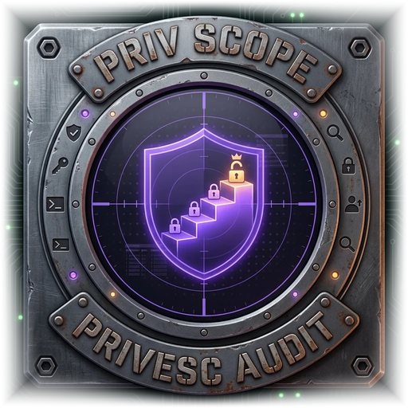

<p align="center"></p>

# privscope

Defensive-first local privilege-escalation **audit** tool for Windows and Linux.

`privscope` tells you what's misconfigured on a host, *why* it's exploitable, *how* to fix
it, and *what changed* since the last run. Its collector and analyzer are strictly
**detect-and-report**: they perform no exploitation and change nothing on the target. An
opt-in third piece, `privscope attack`, generates gated detection-test scripts for
authorized IDS/IPS validation (see [REDTEAM.md](REDTEAM.md)).

It is split in two so the part that runs on the host stays small, read-only and quiet, while
all the judgment lives offline where it can be versioned, re-run and diffed.

Write-up: <https://magikh0e.pl/pubCode/privscope.html>

| Part | Where it runs | What it does |
|---|---|---|
| **Windows collector** | On the target: `collector/Invoke-PrivscopeCollector.ps1` | Read-only PowerShell (5.1 and 7). Dumps configuration *facts* to JSON. |
| **Linux collector** | On the target: `collector/privscope-collect.sh` | Read-only POSIX `sh` + `awk` + `find` + `stat`, so it runs on GNU/Linux and BusyBox systems (Alpine, containers, appliances) with nothing installed. |
| **Analyzer** | Offline: `python -m privscope` (Python 3.9+, standard library only) | Applies the rules for the collection's platform, reports each finding with evidence, why it matters and how to fix it, and diffs two runs. |

The browser version of the analyzer will run the same rule files.

A third, opt-in piece — `privscope attack` — turns findings into a gated **detection-test
script** for validating host-based IDS/IPS. The collector and analyzer never touch it and
stay read-only; see [REDTEAM.md](REDTEAM.md).

## Scope & authorized use

For auditing systems **you own or are explicitly authorized to assess**: your own machines,
a home lab, or a sanctioned engagement. The collector and analyzer never exploit anything.
The optional `privscope attack` detection-test packs (REDTEAM.md) do run real techniques, so
they are for authorized testing only and are gated behind an on-host authorization marker.

## Quick start

On a Windows target (no install needed):

```powershell
powershell -ExecutionPolicy Bypass -File .\Invoke-PrivscopeCollector.ps1
# -> privscope-<HOSTNAME>-<yyyyMMdd-HHmmss>.json
```

On a Linux target (no install needed):

```sh
sh privscope-collect.sh                 # add --no-sudo to skip `sudo -n -l`
# -> ./privscope-<host>-<yyyyMMdd-HHmmss>.json
```

Run either one as an ordinary account for the realistic view of what that account can
reach, or elevated / as root for the most complete picture (the analyzer then judges access
as any ordinary account would have it).

Anywhere with Python:

```powershell
python -m privscope analyze privscope-HOST-20261118-120000.json
python -m privscope analyze collection.json --format html -o report.html
python -m privscope analyze collection.json --format md -o report.md
python -m privscope diff before.json after.json --format html -o diff.html
python -m privscope rules
python -m privscope attack collection.json -o pack.sh   # gated detection-test pack (REDTEAM.md)
```

Or `pip install .` for a `privscope` command.

| Option | Meaning |
|---|---|
| `--perspective auto\|principal\|standard-user` | Whose access counts. `principal`: the account that ran the collector. `standard-user`: any non-admin account (Windows) / any account other than root (Linux). `auto` (default): `standard-user` if the collector ran elevated or as root, otherwise `principal`. |
| `--min-severity` | Leave out findings below `info`/`low`/`medium`/`high`/`critical`. |
| `--format text\|md\|html\|json` | Terminal text, a Markdown report, a single-file HTML report, or JSON for other tools. HTML reports have no scripts or external resources and carry a Content-Security-Policy that forbids both, since everything in them comes from the scanned host. |
| `--fail-on SEVERITY` | Exit 3 if any finding (for `diff`: any *new* finding) is at least this severe. |
| `--brief` | Text only: leave out the why / fix / references. |

On Windows, if the collector ran as an administrator **without** elevation (a UAC split
token), the `principal` view shows what non-elevated code in that session can reach
*without a UAC prompt*, i.e. silent elevation paths. On Linux, the `standard-user` view also
counts the non-root owners and groups of files root runs: a root cron job running a script
that belongs to an ordinary user is a finding.

## What it checks

**Windows**: 32 rules in `privscope/rules/windows/`:

| Area | Checks |
|---|---|
| Services | Overwritable executable, folder that accepts new files (DLL planting), unquoted path that can / can't be hijacked, missing executable that non-admins can create |
| Scheduled tasks | SYSTEM / service-account / highest-privilege tasks whose program is overwritable, missing but creatable, or in a writable folder; disabled ones that would be |
| Logon programs | HKLM Run entries that are overwritable, missing but creatable, have a hijackable unquoted path, or sit in a writable folder |
| System PATH | Writable folders, and missing folders that non-admins could create |
| Policy | AlwaysInstallElevated, UAC off / no prompt / no secure desktop, remote UAC filtering off, WDigest, LSA protection, Point and Print, WSUS over HTTP, LM/NTLMv1 |
| Account | Privileges that lead to SYSTEM (SeImpersonate, SeBackup, SeDebug...), admin-equivalent groups, docker-users |
| Credentials | Readable or leftover setup answer files, autologon password in the registry, PowerShell history |

**Linux**: 37 rules in `privscope/rules/linux/`:

| Area | Checks |
|---|---|
| setuid / capabilities | Writable setuid/setgid programs, setuid-root programs that can run commands or write files, setuid programs outside the system folders, file capabilities that lead to root |
| cron / systemd / boot | Root jobs and services whose program is overwritable, replaceable through its folder, or missing but creatable; writable unit files; writable init scripts and rc.local |
| root's PATH | Writable, creatable, relative or empty entries in sudo's secure_path, /etc/environment, /etc/login.defs and cron's PATH; the WSL Windows PATH |
| Files root relies on | Writable passwd/group/shadow/sudoers/PAM, readable password hashes, writable cron/systemd/init/loader configuration and shell startup files, readable /root |
| Loader, NFS, sockets | Writable preloaded libraries and loader folders, no_root_squash exports, writable Docker/Podman/containerd sockets |
| sudo | Passwordless sudo for anything or for programs that can run commands, rules running writable programs, wildcards, env_keep of LD_PRELOAD and friends (from `sudo -n -l`, and from sudoers when run as root) |
| Account | docker/lxd/incus/disk/libvirt (root-equivalent), shadow, adm |
| Credentials | Other accounts' readable SSH keys, cloud/database/git credential files and shell history |

## What the collectors deliberately do NOT do

- **No modifications.** No writes, no service restarts, no "can I write here?" test writes.
- **No judgments.** They record raw ACLs / modes and the account's SIDs / ids; the analyzer
  decides what's writable. No privilege-escalation logic runs on the target.
- **No secret contents.** For answer files, autologon, shadow, SSH keys, credential files and
  shell history they record presence, path and file metadata only, never the contents.
- **No language assumptions.** On Windows, groups, integrity level and task principals are
  recorded by SID and `whoami` output is read by column; on Linux, everything is parsed in
  the C locale.

The Linux collector's one side effect: `sudo -n -l` never prompts, but sudo logs the query
and, for accounts that aren't in sudoers, may mail the administrator. Use `--no-sudo` where
that matters.

## Writing rules

Rules are JSON data, not code. `RULES.md` defines the format and the exact evaluation
semantics, the contract that both the Python and browser engines implement. Every rule
needs at least one case in `tests/conformance/` that expects it to fire; the test suite
fails otherwise.

```powershell
python -m unittest discover -s tests -t .
```

`tests/lab/` holds a deliberately misconfigured Debian container with known answers. With
Docker available, `python tests/lab/run_lab.py` builds it, runs the Linux collector inside it
as a normal user and as root, and checks the findings against `tests/lab/expected-*.txt`.

## Layout

```
collector/Invoke-PrivscopeCollector.ps1   read-only Windows collector
collector/privscope-collect.sh            read-only Linux collector
schema/privscope-report.schema.json       Windows collection format (JSON Schema 2020-12)
schema/privscope-linux.schema.json        Linux collection format
privscope/                                Python analyzer; rules/<platform>/ holds the rules
RULES.md                                  rule format + evaluation contract
REDTEAM.md                                the opt-in detection-test packs
privscope/redteam/                        'attack' pack generator (never run on the target)
tests/conformance/                        shared cases for both engines
tests/lab/                                misconfigured container + end-to-end check
```

## Roadmap

- [x] Windows collector and 32 rules; Linux collector and 37 rules.
- [x] Python analyzer: text/Markdown/HTML/JSON reports, run-to-run diff, `--fail-on`.
- [ ] Browser analyzer: drop the JSON in, same rule files, offline report (fwscope-style).
- [ ] Windows: service registry-key DACLs and service permissions (sc sdshow).
- [ ] Linux: POSIX ACLs (getfacl), writable sudo-run scripts' interpreters, kernel/package
      versions for known local-privilege-escalation CVEs.
- [ ] Patch/driver/kernel rules fed by cvescope.

## License

GPL-3.0-or-later. See [LICENSE](LICENSE).
